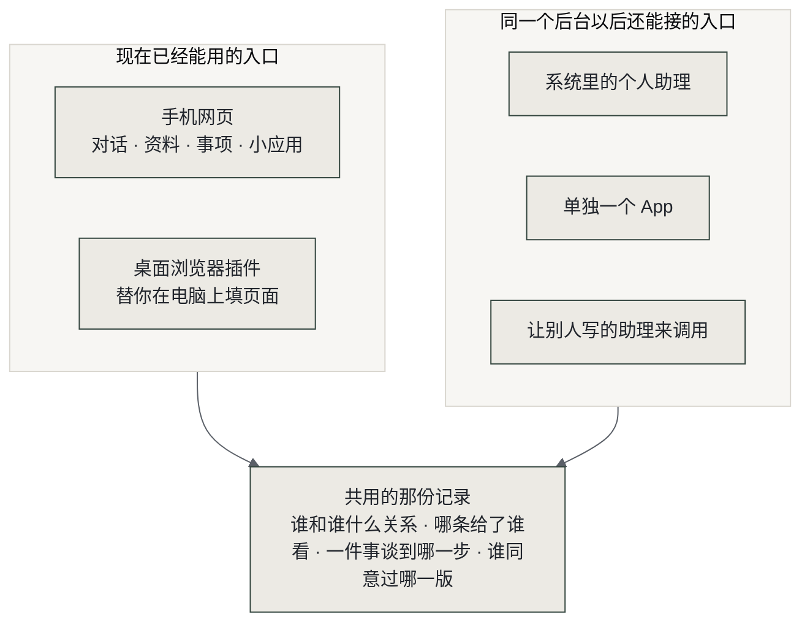
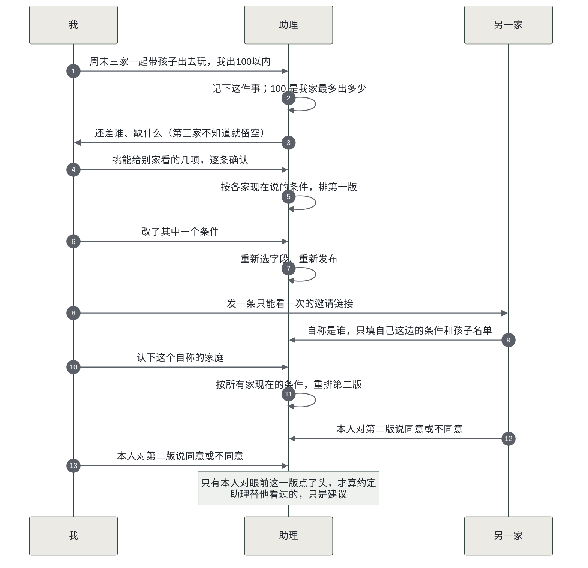
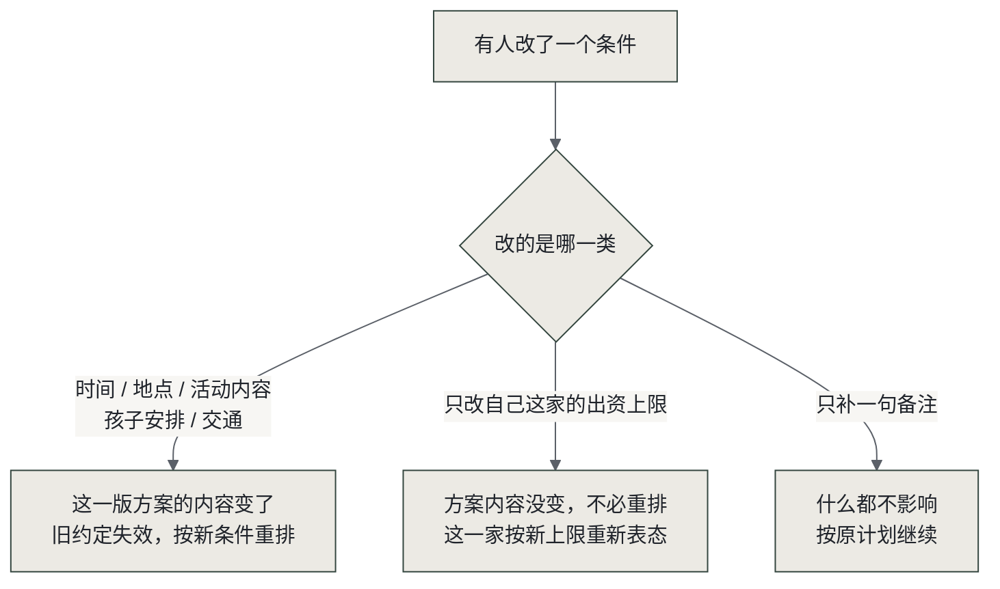
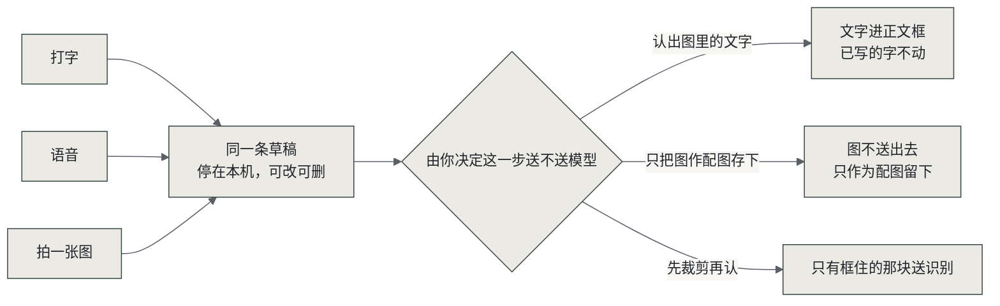

# 我的小助手：记得身边人的情况，与人办事少协调

[](LICENSE)
[](https://www.python.org/)
[](#验证到哪一步)
[](docs/delivery/personal-ai-final-demo.mp4)

**事情在一个地方交办，同一个助手接着办：同一个人的情况不用反复讲，同一个事项的条件不用在几个应用之间搬，改一个要求不用逐处改。**

<p align="center">
  
  
  
  
  
</p>


个人 AI 黑客松作品。

一个人的情况要跟不同的人反复讲。跟老师说孩子这周练了多久琴，跟另一个家长再讲一遍；跟同事交代过的背景，换个项目从头再说；给朋友帮过忙，下次他换了个人对接，你还得再讲一次。过两周自己也要重新回忆。

几个人约一件事缺少记录。群里接龙，有人说了周六可以，后来改成周六上午，先前那次同意是否还有效只能靠记忆。约旅行、排值班、合伙做点什么都一样。

办一件事要查历史。上次送了什么、穿多大码、地址填的哪个、跟对方谈到哪一步，散在聊天记录、相册和收藏夹里，用的时候靠翻。

我做的是个助理。演示主线是家庭活动，另外覆盖送礼、朋友旅行和跨页面采购。

里面有手机优先的对话页、资料库，一个「小应用 · API · 连接器」页（学习软件／周末安排／送礼管家三个轻量应用，加数据接入与关系分类），还有一个 Chrome 插件。送礼和商店代填是另外的模拟用例，跟家庭活动不是一回事。

## 产品定位

一个记着你身边人和身边事的助理。它替你办三件事：把说过的情况存下来，下次不用重讲；把约的事记清谁同意了哪一版，改过之后旧的不算；把送谁的什么都记牢，不用翻聊天记录。

它现在长在手机上，是个网页；桌面上还有个浏览器插件，替你在电脑上填页面。同一份记录两边都用，所以在这边改的，那边接着认。

同一个后台以后还能接别的入口：系统里的个人助理、单独一个 App、或者让别人写的助理来调用。现在只有网页和插件这两个入口，后面几种还没做。



| 入口 | 能干什么 |
|---|---|
| 手机网页 | 对话交办、资料库、事项跟进；小应用页里有学习软件、周末安排、送礼管家，也能接自己的应用和设备 |
| 桌面浏览器插件 | 在电脑上按你授权的字段代填页面，回执回到同一件事 |

小应用、数据接入、连接器都是网页里的页面，是同一些记录在不同事情上的用法。

## 核心：多方协商

约一件事的难处不在没有人答应，而在答应之后又改了，先前那次同意是否还有效无从查证。这里把每次约定拆开记录：每一版都有编号，谁同意了哪一版分别记下；条件变更后，旧的一版立即失效，各方对新的一版重新表态。



三条规矩：

- 助理以你的名义先看一版，只是建议。要你本人点了头才算。
- 只有当前这一版的同意有效。条件变更后，先前的同意立即失效。
- 你没让看的资料，助理拿去用的时候连提都不会提。

### 条件变更后的处理



### 录入方式

打字、语音、拍图、从图里认字，四种都能进同一条草稿。草稿在离开设备之前一直停在本机，你可以改、可以删、可以放着以后再来；每一次要不要送模型，都由你点那一下决定。



走错路也不丢东西：识别失败会说原因，图和已写的正文都留着；取消草稿不会多出一条记录。

## 特色功能

| 功能 | 你得到什么 |
|---|---|
| 拍图识字 | 拍一张通知或便签，字直接进正文，认完还能改。图先进本机草稿，要不要送出去由你点那一下决定 |
| 送礼管家 | 谁穿什么码、喜欢什么、上次送了什么、明确说过不要什么，分开记在自己名下。下次说「给爸爸买双鞋」，它拿这些答，缺的照实问 |
| 学习软件与周末安排 | 孩子这周练了什么、哪条线很久没动，一处看齐；周末和谁有关、各家什么条件、还在等谁，不用挨个问 |
| 接入自己的应用和设备 | 自己开发的应用、别人的开放接口、家里的设备都能接进来。接进来的数据先存本人资料库；要拿去给建议用，得你逐条、逐字段授权 |
| 电脑端代填 | 在桌面浏览器里按你授权的字段代填页面，页面实际值读回来，回执回到同一件事 |

接入的应用和设备是同一份记录的另一半。给妈妈做的用药提醒应用、她戴的智能手表接进来，你问血压怎么样、药有没有按时吃，它答的是这些应用和设备里的数据，她本人不用装你的助理。智能手表这类设备当前还是预留位，标着建设中，接入前不读取任何数据。

## 本地运行

需要 Python 3.10+ 和一个 OpenAI 兼容的模型接口。下面是在 macOS／Linux 用守护方式启动，Windows 请按[运行指南](<docs/run-standalone.md>)用前台入口。

```bash
python3 -m venv .venv
source .venv/bin/activate
pip install -r requirements.txt
PA_MODEL_BASE_URL="https://你的模型接口/v1" \
PA_MODEL_NAME="你的模型名" \
PA_MODEL_API_KEY="你的密钥" \
python start_server.py 8000
```

本机已经有代理的话，直接 `python start_server.py 8000` 就行。默认接口是 `http://127.0.0.1:10100/v1`，默认模型标签是 `step/step-5-preview`。这个代理不随源码分发，换一台电脑不能照抄这个地址就假定模型可用。

电脑打开 `http://127.0.0.1:8000`。手机要在同一局域网，扫首页「⋯ → 演示设置 → 手机访问 → 在手机上打开」里的二维码，电脑得保持开机。手机上的 `127.0.0.1` 指的是手机自己，访问不到电脑。

服务默认监听 `0.0.0.0`，只本机用就设 `PA_BIND=127.0.0.1`。局域网访问限本机使用，没有公开注册登录。相机、麦克风和安装到主屏能不能用，由浏览器决定。

普通用户用已经启动好的服务就行，不用配模型，也不用切换身份。密钥存在本地运行库里，不要随源码分享。

## 使用示例：家庭活动

几个家庭一起办事，各人把自己的情况说一次就存下。约家庭聚会、几家一起出游、合伙做点什么都行：时间、预算、孩子来不来，各家补一次；之后助理记着，你这边随时看得到还差谁、差什么，不用挨个问。

改了时间或预算，只有受影响的约定要重新确认，别家不用把话再讲一遍。

约朋友一起旅行也走这条链，问的是另外几项：目的地、假期长度、人均预算、住宿标准、能否带伴侣、忌口或体力。说「五一约朋友去云南」就按旅行记，不会混进家庭活动。带谁一起你说不说都行，说了名字的进这件事，没说的按报人数的那位代记一笔。

1. 说「周末三家一起带孩子出去玩，我出100以内」，在回复里打开同一件事。100 元是你自己最多愿意出的钱，不是活动总预算，也不是答应了要付。
2. 看看当前知道的情况：有哪些家庭、哪些孩子、什么还没确认。演示里小周和小林是一家的两口子，算一个家庭；第三家不知道就留着缺口，不把配偶算成第三家。
3. 按现在有的条件排候选。没回应就是还没确认。
4. 改自己的时间、出资上限这些条件，然后重新排一版。旧的接受跟着失效，历史记录还在。失败了会告诉你为什么，可以重试。

想请别的家庭参与，从事项里「邀请另一个家庭参与 → 生成单次邀请」拿一条专用链接。对方在自己浏览器里打开、自称是谁、只填自己这边的条件和孩子的名单；你认下这个自称的家庭之后，才按所有人眼下的条件重排一版，再由他本人对这一版说话。他不能直接同意旧的那一版。链接只认这一次，不代表实名，也不会把别人的资料安到他头上。

名单上有几个孩子，不等于这几个孩子都来。来的、不来的、待定的分别记。

资料保存后选「用于家庭活动」，默认一样都不外传。先关联你自己的来源，再挑核对过的短字段原值，确认别家可见才公开。改过或撤过之后，先前的同意失效，要重新选、重新公开、重新排。

## 资料录入与复用

从「☰ → 资料库 → 添加资料」进去。「记什么」那个框打开就能写，不用先拍照也不用先选人。

- **图片识别**：点了这一级选项再选一张本地图。图先进草稿，缩略图马上能看见，这时候还没送出去。弹层里再挑：
  - 「识别图里的文字，进正文框」：只有点这一下，图才送去做识别。文字加在原正文后面，中间换行，你已经写的字不动。
  - 「只把图存进资料库，不识别」：点这一下图不送出去，只作为配图跟着记录存。
  - 「先裁剪再识别」（次级）：只有框住的那块送识别，取消裁剪就不调。整张图在离开设备之前不会先送出去。
- **语音输入**有两条路。服务端转写要配一个密钥，配好就能用（怎么配见[运行指南](<docs/run-standalone.md>)）。浏览器识别用系统自带的能力，要求从本机地址或 https 打开：电脑上 `http://localhost:8000` 可以，手机连局域网 IP 打开时浏览器不给用。两条都不可用时按钮会停用并说明原因。
- 核对错字、对象和发生日期之后再保存，再打开记录看看正文、来源和配图对不对。
- 识别失败会说原因，图和已经写的正文都留着，可以改、可以重试、也可以放着以后再来。认不出字的时候不会硬填一段。取消草稿不会多出一条记录。

存的时候选记在谁名下，之后能关联到某件事。给别家看什么你逐条挑，默认一条都不给。下次问“小雨这周数学练得怎么样”，助手拿你存的那条回答，带得出是哪天、谁记的、依据是什么。

保存资料本身不等于同意分享出去、答应别人什么事、或者去执行。要用在哪件事上，由你自己挑。资料上写的日子和事情定的日子是两回事，分别核对。

学习记录和周末安排这两个视图用的是作品内的测试数据，不是接进了真实的学校软件、微信或手表。

## Chrome 插件：电脑端的执行

手机上交办的事，最后要落在某个网页上。插件就是这双手：它在桌面 Chrome/Edge 里代替你操作页面，把同一件事的参数填进去，再把页面实际值读回来。

它和主应用是同一个助手。你在手机上说「给爸爸买双走路舒服的鞋，300 以内」，条件和来源都记在那件事里；电脑上打开商店页面，插件按你授权的字段把参数填好。填完不是终点。插件把页面实际值读回来，主应用里同一件事能看到回执，手机上打开同一件事也是看这份回执。所以事情走到哪一步，在哪个设备上看都一样。

现在的版本做到代填和回执。理想态是把这条链走完：填参数、提交订单、到你确认支付为止。支付那一下始终由你本人点，插件不替你决定花不花这笔钱。

要看代填，先另开一个终端起内置的模拟商店：

```bash
python -m http.server 9000 --bind 127.0.0.1 \
  --directory extensions/context-bridge/fixtures/mock-shop
```

1. 在主应用「⋯ → 演示设置 → 浏览器插件」拿配对码，到插件里连上自己的服务。加入一次长期有效：重开浏览器、换页面都保持着，只有在演示设置里撤销这台设备才失效。
2. 选自己的购物事项，看这次的需求、来源、还没确认的项，可以复制需求说明。换页面继续同一件事，改过了就重新取当前参数。
3. 在支持的模拟商店页面预览参数，你确认后代填。插件会把页面实际值读回来，主应用里同一事项能看到回执。
4. 没适配的网页就复制需求、自己动手。

边界：插件固定只访问本机 8000／8097／9000／8098；当前不提交订单、不付款；只按你授权的字段代填已批准的商店页面。Android 上的 Chrome 不支持安装扩展，手机不能安装也不能配对，手机上能看到的是同一事项的代填回执。家庭活动的计划不会进只给购物用的参数包。重置演示资料会清掉插件设备和配对，连过的要重连。

## 安全与数据说明

模型管抽取、提案、审阅、读图、提建议；程序管身份、授权、预算依据、品类规格和同版本接受。过期的、跨事项的、没确认的方案都不能拿去执行。误点确认也不该留下接受、约定或者订单的痕迹。

演示里的人物、关系、商品都是编的，购买、支付、物流全是 `simulated`，没有真实交易。文字和你选定识别的图会送到运行者配的模型服务；看附件的权限和给模型处理用的授权是两套检查。请只用不敏感的编造数据演示。

## 能用到什么程度

主线都在真实模型下跑通：拍图识字、按改过的条件重排方案、一次性邀请、来宾自称并补条件、双方各自对当前版本表态。安卓真机上相机实拍、手指裁剪、真麦克风、手机同事项回执可用。演示视频 3 分 26 秒，1280×960，无音轨。

三处产品里能操作、视频里没拍：送礼协商、演示设置面板、连接器配置面板。

没做的：完整模型测试套件没有复跑，另一台电脑的干净安装没有验证。

源码带十个测试文件和两个 Node 单测（共 42 条用例），跑法见[运行指南](<docs/run-standalone.md#测试不是日常启动命令>)。工程里还有一些历史脚本硬编码 8000、写固定临时文件或者直接动运行库，别在日常实例上批量跑。

## 已知边界

服务端语音转写需要配一个密钥，配好后可用。没配时接口如实返回不可用与原因，并给出打字或输入法转文字的替代办法。转写走的是 Step 的音频对话模型，实现细节与踩坑记录见[语音核查摘要](<docs/delivery/verification-summary.md>)。

浏览器识别的「说一段」不经过本作品服务端，可用范围由浏览器决定：本机 `http://localhost` 或 `https://` 打开时可用，手机连局域网 IP 打开时浏览器不提供这个能力，按钮会提前停用并说明原因。按住期间持续识别，换气停顿不中断，松手才停。真麦克风下的连续说话还没实测。

Step 这一环节的证据到配置标签和能核对的实际调用范围为止。真实电商、群消息发送、外部 Agent 接力、语义检索、公开多用户认证都没做。

## 代码结构

```text
app/                 数据、模型客户端、协商与 HTTP 服务
app/static/          手机优先页面和轻量演示视图
extensions/context-bridge/   Chrome 插件、测试和模拟商店
scripts/             原创图标生成脚本
tests/               限定参与、资料关联和客户端重试测试
start_server.py      启动与局域网地址入口
run.py               本机运行入口
```

源码在 <https://github.com/larisfavour-lang/personal-ai-hackathon>，public，MIT。仓库里有全部可分发代码、文档和测试，按 <a href="#本地运行">本地运行</a> 的步骤在本机跑起来。
