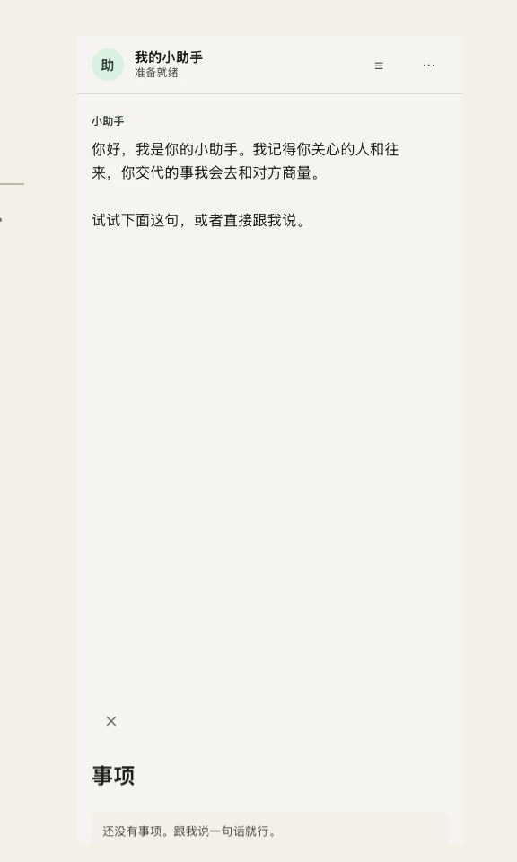
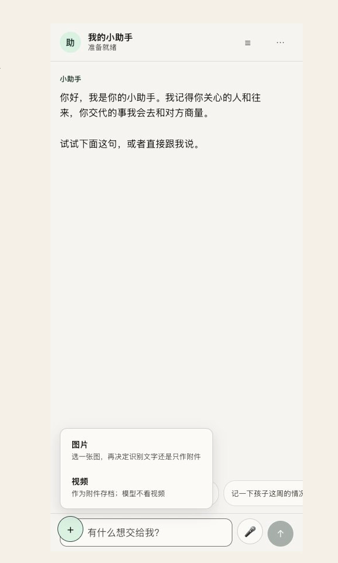
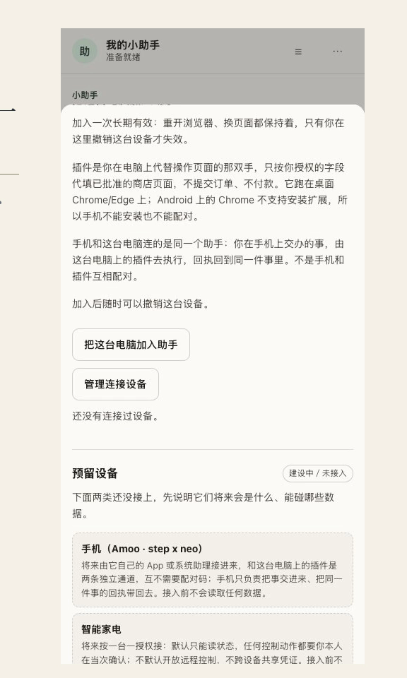
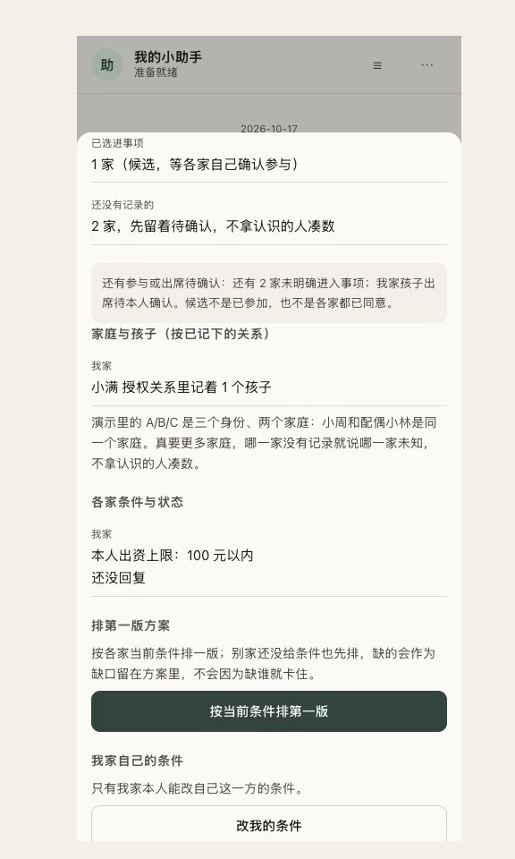
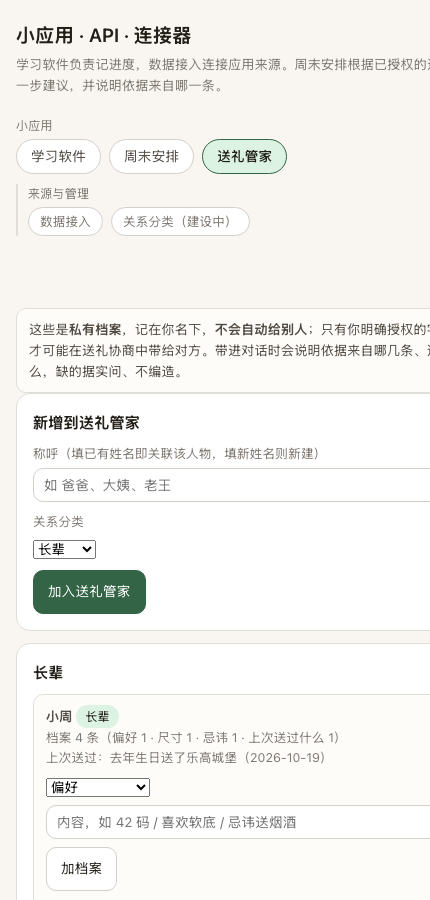
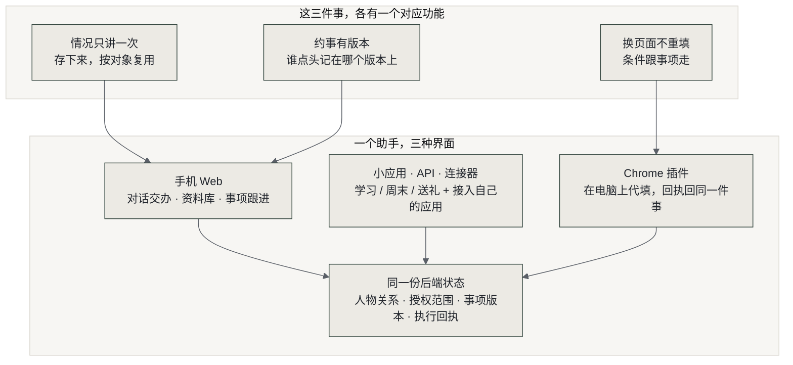
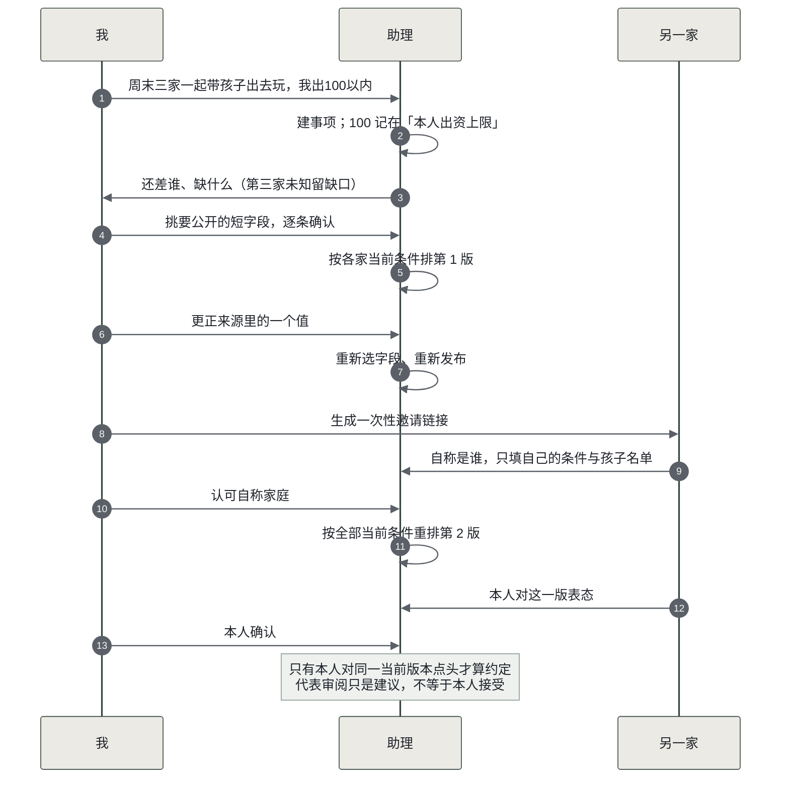
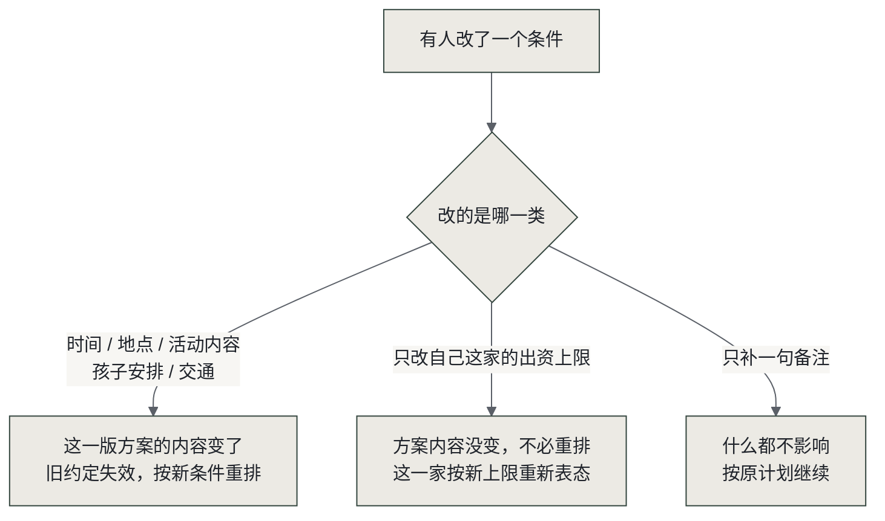
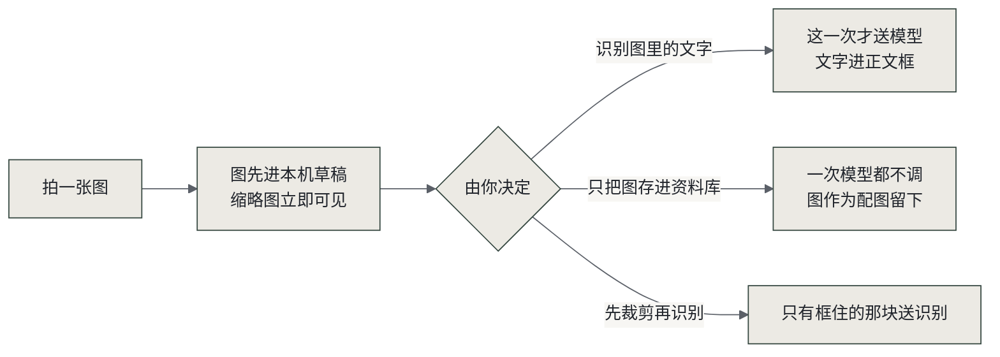

# 我的小助手：记得身边人的情况，与人办事少协调

[](LICENSE)
[](https://www.python.org/)
[](#验证到哪一步)
[](docs/delivery/personal-ai-final-demo.mp4)

**事情在一个地方交办，同一个助手接着办：同一个人的情况不用反复讲，同一个事项的条件不用在几个应用之间搬，改一个要求不用逐处改。**

<p align="center">
  
  
  
  
  
</p>


个人 AI 黑客松作品。

一个人的情况要跟不同的人反复讲。跟老师说孩子这周练了多久琴，跟另一个家长再讲一遍；跟同事交代过的背景，换个项目从头再说；给朋友帮过忙，下次他换了个人对接，你还得再讲一次。过两周自己也要重新回忆。

几个人约一件事，没有版本。群里接龙，有人说了周六可以，后来改成周六上午，之前那句“可以”还作不作数只能靠记忆。约旅行、排值班、合伙做点什么都一样。

办一件事要查历史。上次送了什么、穿多大码、地址填的哪个、跟对方谈到哪一步，散在聊天记录、相册和收藏夹里，用的时候靠翻。

我做的是个助理。演示主线是家庭活动，另外覆盖送礼、朋友旅行和跨页面采购。

里面有手机优先的对话页、资料库，一个「小应用 · API · 连接器」页（学习软件／周末安排／送礼管家三个轻量应用，加数据接入与关系分类），还有一个 Chrome 插件。送礼和商店代填是另外的模拟用例，跟家庭活动不是一回事。

## 这是什么

要解决的是三件事：同一个人的情况跟不同的人反复讲；几个人约一件事没有版本，改了口径对不上；换个页面办同一件事，条件从头再填。



三种界面共用同一份后端状态，所以在一个地方改的条件，另一个地方接着用。Web 是当前的演示载体；同一份后端状态还能接系统级个人助理，或者开放给第三方应用与 Agent 调用。

| 界面 | 做什么 | 现在到哪一步 |
|---|---|---|
| 手机优先 Web | 对话交办、资料库、事项跟进 | 可用，演示主路径 |
| 小应用 · API · 连接器 | 三个轻量应用，加接入自己的应用与设备 | 可用；三方开放 API 为明确标注的模拟数据 |
| 桌面 Chrome 插件 | 在电脑上代填页面，回执回到同一件事 | 可用；只跑桌面 Chrome/Edge，Android 不支持装扩展 |

## 核心：多方协商

这不是「群里接龙」。每个方案有版本号，谁点了头记在哪个版本上；本人没点头就不算约定，
也不拿没确认的人凑数。



**代表审阅不算本人接受**（模型以你名义看一版只是建议）；
**同一个版本才计数**（改条件后旧同意立刻失效）；**未授权的数据进不了模型**（连提示词里都不出现）。

### 条件改了，不一定都要重排



### 图先落草稿，送不送你说了算



## 特色功能

| 规则 | 具体怎么做 |
|---|---|
| 私有来源和对外可见是两件事 | 资料先私有关联到事项，默认一个字段都不选。要别家看见什么，你逐条挑已经核对过的短字段原值、再确认一次；正文和图片不会自动共享 |
| 代表审阅不算本人接受 | 模型可以以你的名义先看一版方案，但那只是建议。只有你本人对当前这一版点了头才算数，发起人也填不了别家的条件 |
| 同一个版本才计数 | 改一个时间或出资上限，旧的接受立刻失效，要重排新版、各方重新表态。接受的是旧版本不能算约定 |
| 再次采用要能证明 | 方案里可以说“用了新值”，但服务器当前版本的出处必须真的指向你改过之后重新选中的那个字段 |
| 随行说不说由你定 | 加入共同事项时可以只报人数，也可以说出随行是谁。没配自己助手的随行者，默认由声明的参与者代他决策；代决策单独记账，不计入“已约定” |
| 同一套引擎换场景 | 条件字段按场景配置：家庭活动一套，朋友旅行一套。学习软件、周末安排、送礼管家、数据接入共用同一份记录和状态 |
| 未授权的数据进不了模型 | 送礼档案、连接器导入的记录都按字段授权；没授权的条目连提示词里都不出现 |

自己开发的应用和设备都能接进来。学习软件接进来，家长在一个对话里就看到孩子这周进展，不用在几个 App 之间切。给妈妈做的用药提醒应用、她戴的智能手表接进来，你问血压怎么样、药有没有按时吃，它答的是这些应用和设备里的数据，她本人不用装你的助理。智能手表这类设备当前还是预留位，标着建设中，接入前不读取任何数据。

## 本地运行

需要 Python 3.10+ 和一个 OpenAI 兼容的模型接口。下面是在 macOS／Linux 用守护方式启动，Windows 请按[运行指南](<docs/run-standalone.md>)用前台入口。

```bash
python3 -m venv .venv
source .venv/bin/activate
pip install -r requirements.txt
PA_MODEL_BASE_URL="https://你的模型接口/v1" \
PA_MODEL_NAME="你的模型名" \
PA_MODEL_API_KEY="你的密钥" \
python start_server.py 8000
```

本机已经有代理的话，直接 `python start_server.py 8000` 就行。默认接口是 `http://127.0.0.1:10100/v1`，默认模型标签是 `step/step-5-preview`。这个代理不随源码分发，换一台电脑不能照抄这个地址就假定模型可用。

电脑打开 `http://127.0.0.1:8000`。手机要在同一局域网，扫首页「⋯ → 演示设置 → 手机访问 → 在手机上打开」里的二维码，电脑得保持开机。手机上的 `127.0.0.1` 指的是手机自己，访问不到电脑。

服务默认监听 `0.0.0.0`，只本机用就设 `PA_BIND=127.0.0.1`。局域网访问限本机使用，没有公开注册登录。相机、麦克风和安装到主屏能不能用，由浏览器决定。

普通用户用已经启动好的服务就行，不用配模型，也不用切换身份。密钥存在本地运行库里，不要随源码分享。

## 从一件家庭事项开始

几个家庭一起办事，各人把自己的情况说一次就存下。约家庭聚会、几家一起出游、合伙做点什么都行：时间、预算、孩子来不来，各家补一次；之后助理记着，你这边随时看得到还差谁、差什么，不用挨个问。

改了时间或预算，只有受影响的约定要重新确认，别家不用把话再讲一遍。分类规则在 `app/service.py` 的 `PLAN_SCENARIOS`，两个场景各一套，每次改动记进 audit 日志。

约朋友一起旅行走同一条链，条件字段换成旅行那套：目的地、假期长度、人均预算、住宿标准、能否带伴侣、忌口或体力。说「五一约朋友去云南」就会按朋友旅行记下，不会落进家庭活动。随行说不说由本人定，说了名字的进事项，没配自己助手的由声明人代决策。代决策单独记账，不算本人接受。

1. 说「周末三家一起带孩子出去玩，我出100以内」，在回复里打开同一件事。100 元是你自己最多愿意出的钱，不是活动总预算，也不是答应了要付。
2. 看看当前知道的情况：有哪些家庭、哪些孩子、什么还没确认。演示里的 A／B／C 是三个身份，B 小周和 C 小林同户，其实是两个家庭。第三家不知道就留着缺口，不把配偶算成第三家。
3. 按现在有的条件排候选。没回应就是还没确认。
4. 改自己的时间、出资上限这些条件，然后重新排一版。旧的接受跟着失效，历史记录还在。失败了会告诉你为什么，可以重试。

想请别的家庭参与，从事项里「邀请另一个家庭参与 → 生成单次邀请」拿一条专用链接。对方在自己浏览器里打开、自称是谁、只填自己的条件和孩子的名单；你「认可自称家庭」之后，才按所有人当前的条件重排一个新版本，再由他本人对这一版表态。他不能直接接受旧版。链接不代表实名，也不会套用 B／C 的资料。

名单上有几个孩子，不等于这几个孩子都来。来的、不来的、待定的分别记。

资料保存后选「用于家庭活动」，默认一个字段都不选。先关联你私人的来源，再挑已经核对过的短字段原值，确认别家可见才公开。改了或撤了之后，旧接受失效，要重新选、重新公开、重新排。

## 录入、核对与再次使用

从「☰ → 资料库 → 添加资料」进去。「记什么」那个框打开就能写，不用先拍照也不用先选人。

- **图片识别**：点了这一级选项再选一张本地图。图先进草稿，缩略图马上能看见，这时候还没送出去。弹层里再挑：
  - 「识别图里的文字，进正文框」：只有点这一下，图才送去做识别。文字加在原正文后面，中间换行，你已经写的字不动。
  - 「只把图存进资料库，不识别」：点这一下不调模型，图只作为配图跟着记录存。
  - 「先裁剪再识别」（次级）：只有框住的那块送识别，取消裁剪就不调。整张图在离开设备之前不会先送出去。
- **语音输入**有两条路。服务端转写调 `/api/voice/transcribe`，走 Step 的 audio chat 模型，配 `PA_ASR_API_KEY` 即可用。浏览器识别用自带的 SpeechRecognition，要求安全上下文：本机 `http://localhost:8000` 可用，手机连局域网 IP 打开时浏览器不给这个能力。两条都不可用时按钮停用并说明原因。
- 核对错字、对象和发生日期之后再保存，再打开记录看看正文、来源和配图对不对。
- 识别失败会说原因，图和你的正文都留着，可以改、可以重试、可以放着以后再来。模型返回空白不算识别成功。取消草稿不会多出一条记录。

存的时候选记在谁名下，之后能关联到某件事。给别家看什么你逐条挑，默认一条都不给。下次问“小雨这周数学练得怎么样”，助手拿你存的那条回答，带得出是哪天、谁记的、依据是什么。

保存资料本身不等于同意对外分享、答应别人什么事或者去执行。要用在哪件事上，得你自己选，再按对象、用途和授权筛。只是存了、没被采用的内容，不能写成「这次的依据」。资料的发生日期和活动的日期是两回事，分别核对。

学习记录和周末安排这两个视图用的是作品内的测试数据，不是接进了真实的学校软件、微信或手表。

## Chrome 插件：换页面少重说

插件跑在桌面 Chrome/Edge 上：电脑 Chrome 打开 `chrome://extensions`，开开发者模式，加载[插件目录](<extensions/context-bridge>)。插件叫「随身助手」，是你在电脑上代替操作页面的那双手，只按你授权的字段代填已批准的商店页面，不提交订单、不付款。加入一次长期有效：重开浏览器、换页面都保持着，只有在演示设置里撤销这台设备才失效。Android 上的 Chrome 不支持安装扩展，手机不能安装也不能配对；手机上能看到的是同一事项的代填回执。

要看代填，先另开一个终端起内置的模拟商店：

```bash
python -m http.server 9000 --bind 127.0.0.1 \
  --directory extensions/context-bridge/fixtures/mock-shop
```

1. 在主应用「⋯ → 演示设置 → 浏览器插件」拿配对码，到插件里连上自己的服务。
2. 选自己的购物事项，看这次的需求、来源、还没确认的项，可以复制需求说明。换页面继续同一件事，改过了就重新取当前参数。
3. 在支持的模拟商店页面预览参数，你确认后代填。插件会把页面实际值读回来，主应用里同一事项能看到回执（手机上也是打开同一件事看这份回执）。
4. 回执只说明页面被填了、复核结果如何。插件不提交订单、不付款。没适配的网页就复制需求、自己动手，别说成已经代填了真实电商。

插件固定只访问本机 8000／8097／9000／8098。你在手机上交办的事，由这台电脑上的插件去执行，回执回到同一件事里；手机和插件不是互相配对。家庭活动的计划不会进只给购物用的参数包。重置演示资料会清掉插件设备和配对，连过的要重连；平时别重置。

## 安全与数据说明

模型管抽取、提案、审阅、读图、提建议；程序管身份、授权、预算依据、品类规格和同版本接受。过期的、跨事项的、没确认的方案都不能拿去执行。误点确认也不该留下接受、约定或者订单的痕迹。

演示里的人物、关系、商品都是编的，购买、支付、物流全是 `simulated`，没有真实交易。文字和你选定识别的图会送到运行者配的模型服务；看附件的权限和给模型处理用的授权是两套检查。请只用不敏感的编造数据演示。

## 验证到哪一步

这个版本实际跑过的：

- 家庭主线已通过：拍图识字进正文、按改过的来源重排方案、一次性邀请、来宾自称并补条件、发起人认可、双方各自对当前版本点头。最后没有全员约定，结果显示没有全员约定。
- 三方协商已通过，包含改条件后重排、旧的接受失效。
- 插件契约、接口该拒绝的路径、资料关联链已通过。
- 安卓真机跑过：相机实拍、手指裁剪、真麦克风、重开继续、手机同事项回执，由用户本人在自己设备上验过。
- 送礼档案、朋友旅行、关系分类、连接器各自有离线测试。未授权的条目不进模型提示词。
- 演示视频 3 分 26.0 秒，1280×960，无音轨。
演示视频没有覆盖的三处，在仓库文档里可查：送礼协商（我提出／对方接受／模拟订单已登记）、演示设置面板（模型连接／手机访问／加入这台电脑／预留设备）、连接器配置面板（服务商地址／路径／字段映射）。这三处在产品里都能操作，视频时长有限未拍。

没跑的：

- 服务端语音转写已通：用 macOS say 合成的真实中文语音验过，转写内容与音频一致，结果不带情绪标签。不设 `PA_ASR_API_KEY` 时接口如实返回不可用与原因，不返回冒充成功的文字。
- 完整 22 项模型测试没有复跑。另一台电脑的干净安装也没验。

历史基线和以前的失败记录见[验收记录](<docs/acceptance-record.md>)。

源码里带了十个测试文件和两个 Node 单测（共 42 条用例），跑法见[运行指南](<docs/run-standalone.md#测试不是日常启动命令>)。工程里还有一些历史脚本硬编码 8000、写固定临时文件或者直接动运行库，别在日常实例上批量跑；真实模型测试要花钱。

源码只对启动管理器的一行模块 docstring 做了泛化，运行逻辑没动，其余文件按原字节选。ZIP 和公开快照是同一套分发字节，逐文件的原／分发 SHA-256 记在独立的交付映射里。

## 语音与其他边界

服务端语音转写直连 Step，不经本地代理。本地代理只放行 `image_url` 一种 content part，音频 part 在入站解析时就被丢掉，路由表里也没有 `/v1/audio/*`。实测可用的组合是 `stepaudio-2.5-chat` 加 `input_audio`，模型 ID 不带 `step/` 前缀；带前缀返回 `model_invalid`，那个前缀是代理自己加的命名空间。明细见[语音核查摘要](<docs/delivery/verification-summary.md>)。

「说一段」走浏览器自带的 SpeechRecognition，不经过本作品服务端。它受设备、权限和**安全上下文**三重限制：用 `http://localhost` 或 `https://` 打开时可用；用局域网 IP 的 `http://` 打开时不可用，这时界面会提前把按钮停用并写清原因和替代办法，不等用户点了才失败。按住期间持续识别，中间换气停顿不会中断；松手才停。自动化只验了接线通不通，真麦克风还没实测。

Step 的证据到配置标签和能核对的实际调用范围为止，没有百分比，也没有上游原始响应的捕获。真实电商、群消息发送、外部 Agent 接力、语义检索、公开多用户认证都没做。

## 代码结构

```text
app/                 数据、模型客户端、协商与 HTTP 服务
app/static/          手机优先页面和轻量演示视图
extensions/context-bridge/   Chrome 插件、测试和模拟商店
scripts/             原创图标生成脚本
tests/               限定参与、资料关联和客户端重试测试
start_server.py      启动与局域网地址入口
run.py               本机运行入口
```

源码在 <https://github.com/larisfavour-lang/personal-ai-hackathon>，public，MIT。仓库里有全部可分发代码、文档和测试，按 <a href="#本地运行">本地运行</a> 的步骤在本机跑起来。
